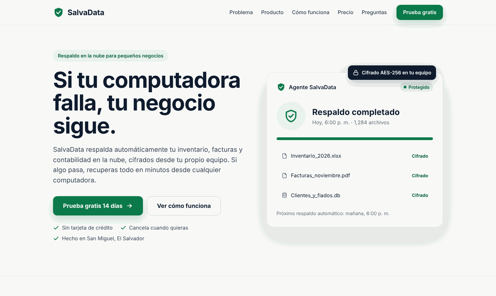
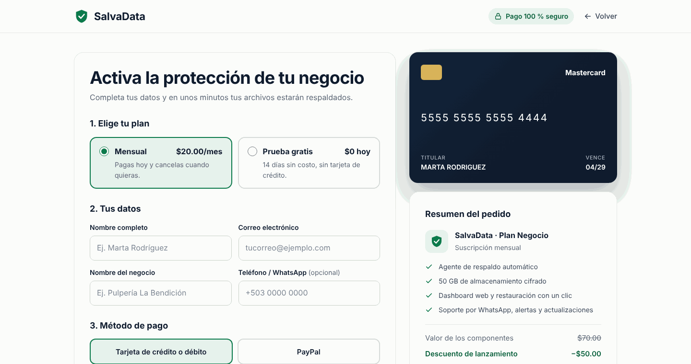
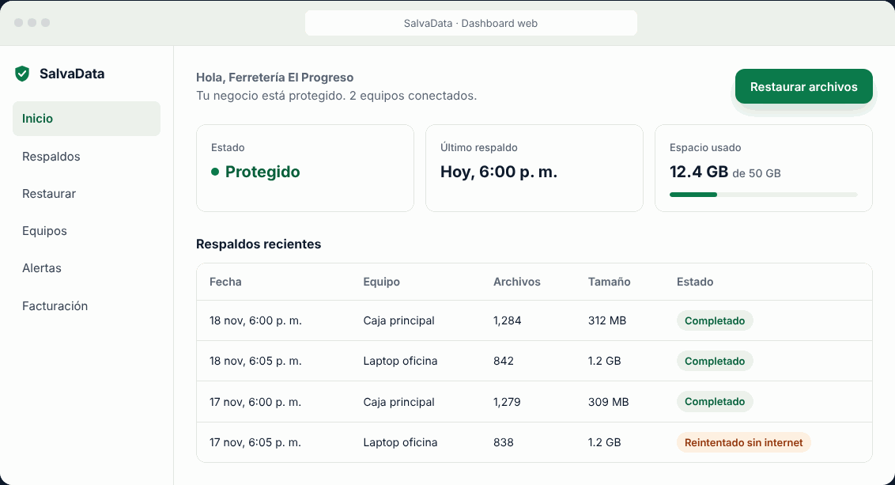
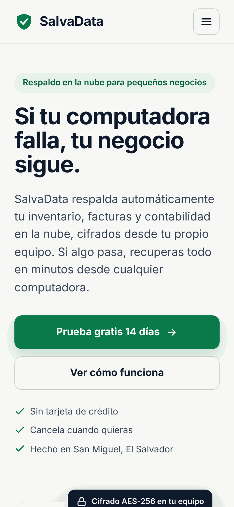

<div align="center">


# SalvaData

**Respaldo automático y cifrado en la nube para pequeños negocios**

Landing page y página de pago de una startup SaaS que protege el inventario, las facturas y la contabilidad de pulperías, ferreterías y pequeños comercios de El Salvador.

[](#-tecnologías)
[](#-tecnologías)
[](#-tecnologías)
[](https://belard7.github.io/salvadata-web/salvadata-web/)
[](#-capturas-de-pantalla)

### [🌐 Ver sitio en vivo](https://belard7.github.io/salvadata-web/salvadata-web/) &nbsp;·&nbsp; [💳 Ver checkout](https://belard7.github.io/salvadata-web/salvadata-web/checkout.html)

<br>



</div>

---

## 📑 Tabla de contenido

- [Sobre el proyecto](#-sobre-el-proyecto)
- [Capturas de pantalla](#-capturas-de-pantalla)
- [Características](#-características)
- [Tecnologías](#-tecnologías)
- [Estructura del proyecto](#-estructura-del-proyecto)
- [Cómo ejecutarlo](#-cómo-ejecutarlo)
- [Probar el checkout](#-probar-el-checkout)
- [Modelo de negocio](#-modelo-de-negocio)
- [Equipo](#-equipo)
- [Aviso](#%EF%B8%8F-aviso)

---

## 💡 Sobre el proyecto

### El problema
En muchos pequeños negocios, toda la información (inventario, facturas, lista de clientes y fiados) vive en **una sola computadora**. Un disco dañado, un apagón, un robo o un ataque de *ransomware* pueden borrar años de trabajo. Además, los respaldos manuales en USB se olvidan o se pierden.

### La solución
**SalvaData** combina un **agente de escritorio** para Windows con un **dashboard web**:

- 🔄 **Respaldo automático diario** de las carpetas que el usuario elija.
- 🔐 **Cifrado AES-256 en el equipo** antes de subir a la nube: nadie más puede leer los datos.
- ⚡ **Restauración con un clic** desde cualquier computadora.
- 🔔 **Alertas** por correo o WhatsApp si un respaldo no se completa.

Este repositorio contiene la **landing page** de venta y la **página de pago (checkout)** del producto, desarrolladas para la asignatura de **Emprendimiento**.

---

## 📸 Capturas de pantalla

<table>
  <tr>
    <td width="68%" valign="top">
      <p align="center"><b>Checkout: pago seguro</b></p>
      
      <p align="center"><b>Mockup del dashboard web</b></p>
      
    </td>
    <td width="32%" valign="top">
      <p align="center"><b>Versión móvil</b></p>
      
    </td>
  </tr>
</table>

---

## ✨ Características

### Landing page (`index.html`)

| # | Sección | Descripción |
|:-:|---------|-------------|
| 1 | **Hero** | Titular con el beneficio principal, subtítulo, imagen representativa y botón de llamado a la acción. |
| 2 | **Problema y solución** | Los tres "dolores" del cliente y cómo SalvaData los resuelve. |
| 3 | **Mockup del producto** | Prototipo del dashboard web con estado, último respaldo, espacio usado e historial. |
| 4 | **¿Cómo funciona?** | Tres pasos: crear cuenta, instalar el agente y dejar que trabaje solo. |
| 5 | **Desglose de valor** | Componentes con su valor individual ($70/mes) frente al precio especial de **$20/mes**. |
| 6 | **Prueba social** | Comparación "antes y después" y testimonios ilustrativos basados en los Buyer Personas. |
| 7 | **Preguntas frecuentes** | 10 preguntas desplegables que resuelven objeciones técnicas. |
| 8 | **Garantía y CTA final** | Prueba gratis de 14 días sin tarjeta y devolución del primer mes en 30 días. |

### Checkout (`checkout.html`)

- 🧾 **Dos planes:** mensual ($20) o prueba gratis de 14 días (oculta el formulario de tarjeta).
- 💳 **Logotipos de marcas** de tarjetas: Visa, Mastercard, American Express, Diners Club, Discover y PayPal.
- 🔍 **Detección automática de la marca** al escribir el número, con resaltado del logotipo.
- 🪪 **Vista previa de la tarjeta** que se actualiza en tiempo real.
- ✅ **Validación completa:** algoritmo de **Luhn**, fecha de vencimiento, CVC de 3 o 4 dígitos y correo.
- 🔗 **Plan preseleccionado** desde la landing mediante parámetros en la URL (`?plan=prueba` / `?plan=mensual`).
- 🎉 **Pantalla de confirmación** con los siguientes pasos para el cliente.

### Calidad

- 📱 Diseño **100 % responsive** con menú móvil desplegable.
- ♿ **Accesibilidad:** HTML semántico, etiquetas ARIA, navegación por teclado y soporte para `prefers-reduced-motion`.
- 🪶 **Sin frameworks ni dependencias de compilación:** abre directo en el navegador.

---

## 🛠 Tecnologías

| Tecnología | Uso |
|------------|-----|
| **HTML5** | Estructura semántica de las páginas |
| **CSS3** | Variables, Grid, Flexbox y *media queries* para el diseño responsive |
| **JavaScript (ES5+)** | Menú móvil, formato y validación del formulario de pago |
| **Google Fonts** | Tipografías *Inter* y *Space Grotesk* |
| **Font Awesome 6** | Logotipos de las marcas de tarjetas |
| **GitHub Pages** | Hosting gratuito del sitio |

---

## 📂 Estructura del proyecto

```
salvadata-web/
├── README.md
├── docs/                    # Imágenes de este README
└── salvadata-web/
    ├── index.html           # Landing page (8 secciones)
    ├── checkout.html        # Página de pago
    ├── css/
    │   └── styles.css       # Estilos y diseño responsive
    └── js/
        ├── main.js          # Menú móvil de la landing
        └── checkout.js      # Lógica del pago: planes, formato, detección de marca y validación
```

---

## 🚀 Cómo ejecutarlo

**Opción 1: en línea**
Abre 👉 **https://belard7.github.io/salvadata-web/salvadata-web/**

**Opción 2: en tu computadora**

```bash
git clone https://github.com/Belard7/salvadata-web.git
cd salvadata-web/salvadata-web
```

Luego abre `index.html` con doble clic. Si prefieres un servidor local:

```bash
python -m http.server 8000
# y abre http://localhost:8000
```

---

## 💳 Probar el checkout

Usa estas tarjetas de prueba, con **cualquier fecha futura** y **cualquier CVC**:

| Marca | Número de prueba |
|-------|------------------|
| Visa | `4242 4242 4242 4242` |
| Mastercard | `5555 5555 5555 4444` |
| American Express | `3782 822463 10005` |

---

## 📊 Modelo de negocio

SalvaData funciona como un **SaaS por suscripción** de **USD 20 al mes** por negocio.

| Concepto | Mes 1 | Mes 2 | Mes 3 |
|----------|------:|------:|------:|
| Suscriptores proyectados | 50 | 80 | 120 |
| Ingresos | $1,000 | $1,600 | $2,400 |
| Egresos totales | $1,545 | $1,627 | $1,828 |
| **Resultado operativo** | **−$545** | **−$27** | **+$572** |

- 📈 **Punto de equilibrio:** mes 3.
- 🛫 **Runway:** unos 10 meses, con un capital semilla de $5,600 y un *burn rate* de $545 al mes.

---

## 👥 Equipo

| Rol | Integrante |
|-----|-----------|
| CEO / Director General | Mario Antonio Barahona Sorto |
| CTO / Director de Tecnología | Marvin Javier Santos Fernández |
| CPO / Director de Producto y Diseño | José Isaac Medrano Ventura |
| Director de Marketing y Ventas | Jimmy Abelardo Rivas Lazo |
| Director de Operaciones y Finanzas | Diego Alexander Zapata López |

---

## ⚠️ Aviso

> [!NOTE]
> Este es un **proyecto académico**. La página de pago es una **demostración**: no envía datos a ningún servidor ni procesa pagos reales. Los testimonios son ilustrativos y están basados en los Buyer Personas del proyecto.

<div align="center">
<br>

© 2026 **SalvaData** · San Miguel, El Salvador

</div>

